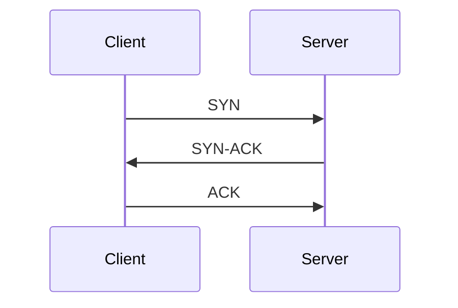

# The Tessera deck format

A deck is one text file: a title, and a list of cards. You can write it in **Markdown** or **JSON**. Both hold exactly the same things, go through the same checks, and give the same result when imported. This page is the reference. If you want Claude to write decks for you, see [claude-workflow.md](claude-workflow.md).

The files in [`examples/`](../examples/) are real decks you can import: `ccna-ospf` (in both formats, side by side), `powershell-essentials` (Markdown, with code), and `tcp-ip-fundamentals` (JSON, with diagrams and a table).

## Which format

|                 | Markdown                                                             | JSON                                                                   |
| --------------- | -------------------------------------------------------------------- | ---------------------------------------------------------------------- |
| Best for        | Writing and reading by hand, decks with code blocks or several lines | Programs that produce decks, and anyone who likes strict structure     |
| Code in a card  | Write it as it is                                                    | Every line break is `\n` and every quote is `\"`                       |
| Errors point to | A line number                                                        | A line and column for syntax mistakes, and the field name for the rest |
| Easy to break   | A label at the wrong place, an indent (see below)                    | A trailing comma, a missing quote                                      |

Tessera works out which one you pasted. For a file, `.md` and `.json` are used only if the text itself does not say.

## A whole deck

This is a complete deck in Markdown with one card of each type:

<!-- prettier-ignore -->
```markdown tessera-deck
---
tessera: 1
id: ospf-basics
title: OSPF basics
description: A few cards to try the four types.
tags: [networking]
---

## ospf-hello
Q: Default OSPF hello interval on broadcast networks?
A: 10 seconds
Hint: The dead interval is 4 times this.
Tags: timers
Source: Lesson 3

## ospf-dr
Cloze: The {{c1::DR}} is elected by highest {{c2::priority}}, then by highest {{c3::router ID}}.
Extra: A priority of 0 means the router never becomes DR or BDR.

## ospf-show-nbr
Q: Command to list OSPF neighbors?
Answer: show ip ospf neighbor
Accept: sh ip ospf nei, show ip ospf nei

## ospf-lsa
Q: Which LSA type describes a network segment?
Choices:
- Type 1
- [x] Type 2
- Type 3
- Type 5
Explanation: The DR originates the Type 2 network LSA.
```

And the same deck in JSON:

```json tessera-deck
{
	"tessera": 1,
	"deck": {
		"id": "ospf-basics",
		"title": "OSPF basics",
		"description": "A few cards to try the four types.",
		"tags": ["networking"]
	},
	"cards": [
		{
			"id": "ospf-hello",
			"type": "basic",
			"front": "Default OSPF hello interval on broadcast networks?",
			"back": "10 seconds",
			"hint": "The dead interval is 4 times this.",
			"tags": ["timers"],
			"source": "Lesson 3"
		},
		{
			"id": "ospf-dr",
			"type": "cloze",
			"text": "The {{c1::DR}} is elected by highest {{c2::priority}}, then by highest {{c3::router ID}}.",
			"extra": "A priority of 0 means the router never becomes DR or BDR."
		},
		{
			"id": "ospf-show-nbr",
			"type": "typed",
			"front": "Command to list OSPF neighbors?",
			"answer": "show ip ospf neighbor",
			"accept": ["sh ip ospf nei", "show ip ospf nei"]
		},
		{
			"id": "ospf-lsa",
			"type": "choice",
			"front": "Which LSA type describes a network segment?",
			"choices": ["Type 1", "Type 2", "Type 3", "Type 5"],
			"correct": 1,
			"explanation": "The DR originates the Type 2 network LSA."
		}
	]
}
```

## The deck

| Field         | Required | Meaning                                                                                 |
| ------------- | -------- | --------------------------------------------------------------------------------------- |
| `tessera`     | yes      | The format version. Always `1`.                                                         |
| `id`          | yes      | The deck's id. Lowercase letters, digits, and hyphens, starting with a letter or digit. |
| `title`       | yes      | The name shown in the deck list.                                                        |
| `description` | no       | One or two sentences about the deck.                                                    |
| `tags`        | no       | Labels for the whole deck.                                                              |

In JSON, `id`, `title`, `description`, and `tags` sit inside `"deck": { ... }`. In Markdown they sit in the block at the top, next to `tessera`. Any other field is refused, and the error lists the allowed ones.

## The cards

Every card has a **type**. Which fields it has depends on the type.

| Type     | Required                         | Optional                            | Studied by                                                        |
| -------- | -------------------------------- | ----------------------------------- | ----------------------------------------------------------------- |
| `basic`  | `front`, `back`                  | `hint`, `tags`, `source`, `id`      | Read the question, recall, reveal, grade yourself                 |
| `cloze`  | `text` (with at least one blank) | `extra`, plus the common ones       | Fill in a blank. Each blank is its own review item                |
| `typed`  | `front`, `answer`                | `accept`, plus the common ones      | Type the answer. It is checked and a grade is suggested           |
| `choice` | `front`, `choices`, `correct`    | `explanation`, plus the common ones | Pick an option (shuffled). It is checked and a grade is suggested |

The common fields are `id`, `hint`, `tags`, and `source`. Every card type accepts them. A field that does not belong to the card's type, for example `extra` on a basic card, is refused.

**`id`** is how Tessera recognizes a card when you import a revised deck, so that your review history stays with it. Use short, meaningful words in lowercase with hyphens (`ospf-hello`), unique within the deck. Cards without an id still work, but are recognized by a hash of their text, so editing the question makes a new card and leaves the old one behind. Importing warns you when that applies. **Always give cards ids.** When you revise a deck, never change an existing id.

**`hint`** is shown only when asked for (press `H`). **`tags`** are for filtering. A tag cannot contain a comma or a line break. **`source`** is a note such as `Lesson 3`.

### Basic

`front` is the question, `back` is the answer. Both are Markdown, so they can hold code, lists, and tables.

### Cloze

`text` holds the sentence with the answers wrapped in `{{cN::answer}}`, where `N` is a number from 1 to 99. Each number is a separate review item: with `c1`, `c2`, and `c3` the card is studied three times, hiding one number each time and showing the others. Several blanks with the same number are hidden together.

```
The {{c1::DR}} is elected by highest {{c2::priority}}.
A hint goes after a second pair of colons: {{c3::router ID::tie breaker}}.
```

Blanks can be nested up to eight deep. A blank that is never closed, has a bad number, or is empty is refused, with the line and column. `extra` is shown after the answer.

Studying one blank buries the card's other blanks until the next study day, so one card does not fill a whole session.

### Typed

The learner types the answer. Tessera compares it with `answer` and with every item in `accept`, and suggests Good for a match and Again for a miss. The learner can always choose a different grade.

What counts as the same: case is ignored, runs of spaces count as one, and a full stop, comma, semicolon, colon, exclamation mark, or question mark at the very end is ignored. Nothing else changes, so `10.0.0.1` never matches `10001`, and `a-b` never matches `ab`. List short forms and spellings you want to accept in `accept`:

```
Answer: show ip ospf neighbor
Accept: sh ip ospf nei, show ip ospf nei
```

Prefer typed cards for commands, terms, and values, where the exact words matter.

### Choice

`choices` has 2 to 8 options. `correct` is the number of the right one, **counting from 0** in JSON. In Markdown you mark it with `[x]` instead, so there is no counting. Two options may not be the same text. The options are shown in a shuffled order that stays the same if the page is refreshed and changes on the next review, so the learner learns the answer and not its position. `explanation` is shown after answering.

Write wrong options that someone could believe. Easy giveaways teach nothing.

## Text in cards

Every text field is Markdown: bold, italic, lists, tables, links, inline `code`, and fenced code blocks. Raw HTML is shown as text, and images are not supported.

**Code blocks** are coloured when you name a language. Highlighted languages: bash, c, cpp, csharp, css, diff, dockerfile, go, html, ini, java, javascript, json, markdown, powershell, python, rust, shellsession, sql, toml, typescript, xml, yaml.

Short names also work: sh, shell, zsh, shellscript, console, ps1, pwsh, js, mjs, ts, py, yml, c++, cs, golang, rs, htm, md, jsonc, docker, conf.

Other languages are shown as plain code. Very long blocks (over 20,000 characters or 600 lines) are also plain.

**Diagrams** are drawn from a `mermaid` code block:

````

````

Flowcharts, sequence, state, class, entity relationship, pie, Gantt, and mind map diagrams are tested. Keep a diagram under 8,000 characters and 200 connections. A diagram that cannot be drawn is shown as its source with a note, and the card still works. Quote labels that contain punctuation.

## Limits

| Limit                              | Value  |
| ---------------------------------- | ------ |
| File size                          | 5 MB   |
| Cards in one deck file             | 5,000  |
| Characters in one text field       | 20,000 |
| Characters in the deck title       | 200    |
| Characters in the deck description | 2,000  |
| Characters in a source             | 200    |
| Tags on a card                     | 32     |
| Characters in a tag                | 40     |
| Choices on a card                  | 2 to 8 |
| Characters in one choice           | 2,000  |
| Accepted answers on a typed card   | 20     |
| Characters in one accepted answer  | 500    |
| Characters in an id                | 64     |

Split a big subject into several decks. Smaller decks are easier to review and to fix.

## JSON

The JSON format is the strict one. The whole file is one object with `tessera`, `deck`, and `cards`. Rules to remember:

- Double quotes only, no trailing commas, no comments.
- A line break inside text is `\n`. A quote is `\"`. A backslash is `\\`.
- If you paste it from a chat that wrapped it in a code block, that is fine. The fence is removed.
- Text before or after the JSON, such as "Here is your deck:", is not fine. The error asks you to remove it.

A schema describing the JSON is at `GET /api/schema` on your server (for example `http://tessera.lan:3000/api/schema`), and in this repository at `static/schema/tessera-deck.v1.schema.json`. Editors and tools can use it to check a deck.

## Markdown

A Markdown deck has a **block at the top**, between two lines of `---`, with the deck fields as `name: value` lines. After it come the cards.

**A card starts with a heading** of two hash marks and its id: `## ospf-hello`. A bare `##` is a card without an id (not recommended).

**Fields start with a label at the beginning of a line**, and a field goes on until the next label or heading. Labels are not case sensitive.

| Label          | Field                                            |
| -------------- | ------------------------------------------------ |
| `Type:`        | The card type, only needed to override the guess |
| `Q:`           | `front`                                          |
| `A:`           | `back`                                           |
| `Answer:`      | `answer`                                         |
| `Accept:`      | `accept`, a comma separated list                 |
| `Cloze:`       | `text` of a cloze card                           |
| `Choices:`     | `choices`, a list underneath                     |
| `Explanation:` | `explanation`                                    |
| `Extra:`       | `extra`                                          |
| `Hint:`        | `hint`                                           |
| `Tags:`        | `tags`, a comma separated list                   |
| `Source:`      | `source`                                         |

**The type is worked out from the labels.** `Cloze:` makes a cloze card. `Q:` with `Choices:` makes a choice card, with `Answer:` a typed card, and with `A:` a basic card. A `Q:` with none of those, or with more than one, is an error that says so.

**A field can run over several lines**, including blank lines, lists, and code blocks. Leading blank lines and trailing spaces are removed, the rest is kept exactly.

````
## ps-where-object
Q: What does this command return?

```powershell
Get-Service | Where-Object Status -eq 'Running'
```

A: Only the services whose `Status` equals `Running`.
````

**Code blocks are not parsed.** A line inside a fenced code block that looks like a label or a heading is just code. A code block that is opened and never closed is an error, because everything after it would be swallowed.

**Choices** are a list under `Choices:`. One item is marked `[x]`, exactly one. The marker is only recognized at the start of an item, so `- [x] Type 2` is the right answer and `- Use [x] to mark` is not. The other items may carry `[ ]` or nothing. An item can continue on the next lines if they are indented by two spaces.

**Lists** (`Tags:` and `Accept:`) are separated by commas or line breaks. To put a comma inside an item, write `\,`. To write a backslash, write `\\`.

**Text that looks like a label.** To start a line of ordinary text with something that looks like a label or a heading, put a backslash in front. The backslash is removed:

```
A: Type this: \Q: is not a field here
```

**Wrapping the deck in a code block**, as a chat usually does, is fine. If the deck itself contains code blocks, the outer fence needs **four** backticks (or `~~~`), so the inner ones do not end it:

`````
````markdown
---
tessera: 1
id: demo
title: Demo
---

## a
Q: What does this print?

```python
print("hi")
```

A: hi
````
`````

Anything between the top block and the first card may only be blank lines, a `# title` line, or an HTML comment. Other text there is an error, because it would be ignored.

**Do not run a Markdown formatter over a deck.** Formatters such as Prettier do not know about the labels. One of them indents the lines after a list, which would turn `Explanation:` into part of the last choice. Tessera refuses an indented line that looks like a label, and the error says so. Keep decks out of automatic formatting.

## When something is wrong

An import never half-works. If anything is wrong, **nothing is saved** and every problem is listed, with the line number for Markdown and syntax mistakes and the field name for the rest. Examples of what you will see:

```text
line 8 [cannot_infer_type] cards[0]: This card has a Q: but no answer, so its type cannot be worked out. Add A: for a basic card, Answer: for a typed card, or Choices: for a choice card.
line 9 [no_correct_choice] cards[0].correct: No choice is marked as the right one. Put [x] after the dash on exactly one choice, as in "- [x] Type 2".
line 8 [unclosed_cloze] cards[0].text: the blank {{c1:: is never closed. Add }} after the answer (line 1, column 5)
line 7 [invalid_format] cards[0].id: id must start with a lowercase letter or digit and use only lowercase letters, digits, and hyphens (maximum 64 characters)
[required] cards[0].back: back is required
[out_of_range] cards[2].correct: correct is 2 but there are only 2 choices (valid indexes are 0 to 1)
```

The import page has a **Copy errors for Claude** button. It builds a message with the problems, in the format of the deck you pasted, and a reminder to keep every id. Paste it into the chat and ask for the corrected deck.

## Importing again

Importing the same deck again is safe. Cards are matched by `id`:

- A card that did not change is left alone, and so is its review history.
- A card whose text changed is updated, and its history is kept.
- A new id makes a new card.
- A card that is in Tessera but not in the file is left alone. Tick **Archive cards that are not in this file** to archive them instead. Nothing is ever deleted by an import.
- Changing a card's **type** resets that card's history, because a different kind of card is a different thing to remember. The preview warns you before you import.
- For a cloze card, adding a blank adds a review item. Removing one archives it.

The **Preview** button shows all of this before anything is saved: what is new, the old and new text of each edited card, the cards that would start over, and warnings such as new cards that look like old cards under new ids.

## Importing without the web page

```bash
curl -X POST -H "Content-Type: text/markdown" --data-binary @deck.md "http://tessera.lan:3000/api/import"
curl -X POST -H "Content-Type: application/json" --data-binary @deck.json "http://tessera.lan:3000/api/import?dry_run=true"
```

`dry_run=true` shows the preview without saving. `archive_missing=true` archives cards the file does not mention. If a token is set, add `-H "Authorization: Bearer YOUR_TOKEN"`. See [deploy.md](deploy.md).
